<h1 align="center">priasolOS</h1>

<p align="center">
  
</p>

<p align="center">
  
  
  
  
  <br>
  
  
  
</p>

<p align="center">
  
  &nbsp;&nbsp;
  
  &nbsp;&nbsp;
  
</p>

<p align="center">
  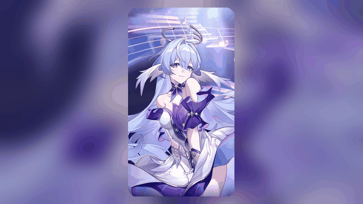
  <br>
  <em>Sistem operasi 32-bit x86 buatan sendiri, dari GDT sampai multitasking.</em>
  <br><br>
  <code>IF2130 Sistem Operasi · Semester Ganjil 2026/2027 · Kelompok priasolOS</code>
</p>

<p align="center"></p>

```text
              _                     _   ___   ____
 _ __   _ __ (_)  __ _  ___   ___  | | / _ \ / ___|
| '_ \ | '__|| | / _` |/ __| / _ \ | || | | |\___ \
| |_) || |   | || (_| |\__ \| (_) || || |_| | ___) |
| .__/ |_|   |_| \__,_||___/ \___/ |_| \___/ |____/
|_|                  ✦  boot · page · schedule · repeat  ✦
```

<p align="center"></p>

## Daftar Isi

<table align="center">
<tr>
<td>

✦ [Kontributor](#kontributor)<br>
✦ [Tentang priasolOS](#tentang-priasolos)<br>
✦ [Fitur](#fitur)<br>
✦ [Main Menu](#main-menu)<br>
✦ [Perintah Shell](#perintah-shell)

</td>
<td>

✦ [System Call](#system-call)<br>
✦ [Galeri Kru](#galeri-kru)<br>
✦ [Prasyarat](#prasyarat)<br>
✦ [Cara Build dan Run](#cara-build-dan-run)

</td>
<td>

✦ [Struktur Direktori](#struktur-direktori)<br>
✦ [Batasan yang Diketahui](#batasan-yang-diketahui)<br>
✦ [Referensi](#referensi)<br>
✦ [Kredit Gambar](#kredit-gambar)

</td>
</tr>
</table>

<p align="center"></p>

## Kontributor

<p align="center">
  
</p>

**Nama Kelompok:** priasolOS

| No. | Nama Lengkap | NIM |
| :---: | :--- | :---: |
| 1. | Andro Irsa Syafiq | 13525129 |
| 2. | Chatima Anandakhorita | 13525133 |
| 3. | Muhammad Nur Fikri Hariyawan | 13525145 |
| 4. | Athallah Nanda Andita | 13525148 |

<div align="center">
  
  <br>
  <em>Maskot Kelompok priasolOS</em>
</div>

<p align="center"></p>

## Tentang priasolOS


priasolOS adalah sistem operasi 32-bit untuk arsitektur x86 (protected mode) yang dibangun mengikuti buku *IF2130 – Book I: Protected Mode x86*. Kernel di-boot oleh GRUB (Multiboot), berjalan di *higher half* (`0xC0000000`), dan diuji di QEMU.

Semua yang ada di sini ditulis dari nol tanpa C standard library: driver, file system, paging, user mode, shell, sampai scheduler. Setelah boot, kernel membuat proses **shell** dari disk EXT2 lalu menyerahkannya ke scheduler. Dari shell, kita bisa menjelajah file system dan menjalankan program lain sebagai proses user yang berjalan bersamaan.

<details>
<summary><b>✦ Alur boot</b> (klik)</summary>


</details>

<details>
<summary><b>✦ Arsitektur</b> (klik)</summary>

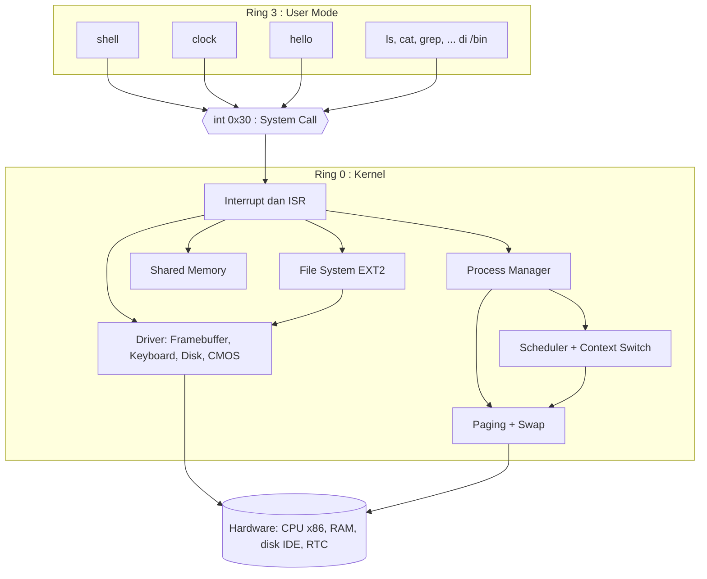

</details>

<details>
<summary><b>✦ Tahukah kamu?</b> (klik)</summary>

- Kernel di-link pada *higher half*, di alamat virtual `0xC0000000`.
- Timer PIT berdetak 1000 kali per detik, dan setiap detaknya scheduler bisa berpindah proses.
- Satu page frame berukuran 4 KiB, setara 8 blok disk (1 blok = 512 byte).
- Area swap berisi 1024 slot (4 MiB) di belakang area EXT2 pada `storage.bin`. Korban page dipilih dari **semua proses** dengan algoritma *clock (second chance)*.
- Kernel mendukung sampai 16 proses sekaligus, masing-masing punya ruang alamat virtual sendiri.
- Jam di pojok kanan bawah adalah program user biasa. Ia bisa dihentikan dengan `kill`, lalu dijalankan lagi tanpa merusak sistem.

</details>

<br clear="right"/>

<p align="center"></p>

## Fitur

<p align="center">
  
</p>

<details>
<summary><b>✦ Milestone 0 · Toolchain, Kernel, GDT</b></summary>

- Kernel C yang di-boot GRUB lewat Multiboot header
- Image ISO bootable dengan GRUB Legacy (`genisoimage`)
- Global Descriptor Table: kernel code/data, user code/data, dan Task State Segment
- Otomasi build lewat `Makefile` dan eksekusi di QEMU

</details>

<details>
<summary><b>✦ Milestone 1 · Framebuffer, Interrupt, Driver</b></summary>

- Text framebuffer 80×25 dengan cursor dan scrolling
- PIC remapping, IDT dengan 64 ISR, dan main interrupt handler
- Driver keyboard PS/2 (scancode set 1, mendukung Shift, Caps Lock, Ctrl, dan tombol panah)
- *Scrollback* layar terminal dengan PageUp / PageDown

</details>

<details>
<summary><b>✦ Milestone 2 · File System EXT2 (IF2130 Edition)</b></summary>

- Driver disk ATA PIO dan disk image `storage.bin` (4 MiB EXT2 + 4 MiB swap)
- EXT2 dengan block group, inode, bitmap, dan directory table
- Pembacaan block langsung sampai *triply indirect*; penulisan memakai direct + single indirect
- Operasi CRUD: `read`, `read_directory`, `write`, `delete`
- Program host `inserter` untuk memasukkan file dan folder ke `storage.bin`

</details>

<details>
<summary><b>✦ Milestone 3 · Paging, Swap, User Mode, Shell</b></summary>


- *Higher half kernel* dengan halaman 4 KiB dan recursive page directory
- Frame allocator dan deallocator
- **Swap space**: page fault handler, swap in/out ke disk, dan page replacement *second chance* (clock) yang bekerja lintas proses. Lokasi page di swap dicatat di PTE (bit 9 + nomor slot), slot otomatis dikembalikan saat proses selesai.
- Akses memori tidak valid oleh program user hanya menghentikan program tersebut (*Segmentation fault*), OS tetap berjalan
- User mode (ring 3) dan system call lewat `int 0x30`
- Shell dengan REPL, pipeline (`|`), redirection (`>` / `>>`), current working directory, `cd ..` dan path relatif, serta `grep` dengan regex
- `cp -r` dan `rm -r` untuk folder (bonus)

<sub><i>Penjaga bagian memori: Black Swan, sang Memokeeper.</i></sub>

<br clear="right"/>

</details>

<details open>
<summary><b>✦ Milestone 4 · Process, Scheduler, Multitasking</b></summary>

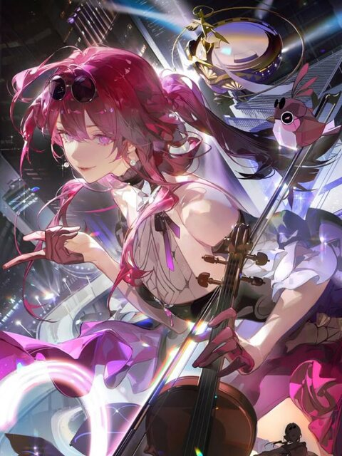

- Process Control Block (maksimal 16 proses) dan ruang alamat virtual terpisah untuk tiap proses
- Scheduler *round-robin* preemptive dengan timer PIT 1000 Hz (IRQ0)
- Context switch ke user mode dengan `iret`
- Syscall `exit` dan `crt0` yang memanggilnya otomatis setelah `main()` selesai
- Manajemen proses dari shell: `exec`, `ps`, `kill`
- Driver CMOS RTC dan program `clock` di status bar (baris terakhir layar)
- Aplikasi eksternal `hello` ("Hello World!")
- **Bonus PATH:** program di folder PATH (default `/bin`) bisa dijalankan cukup dengan namanya dari folder mana pun. PATH dilihat dan diubah dengan `export`, lalu tersimpan permanen di `/.path`.
- **Bonus Separate Shell Commands:** `ls`, `mkdir`, `cat`, `grep`, `find`, `cp`, `rm`, `mv`, `echo`, `clear`, dan `help` kini program ELF terpisah di `/bin` dengan linker dan `crt0` sendiri. Shell mengirim argumen lewat syscall, menunggu prosesnya selesai (tidak ada proses yatim), lalu mengambil output lewat *shared memory*.
- **Aplikasi tambahan:** `rhythm` (ZZZ Rhythm Game + Robin Endless, dengan musik PC Speaker) dan `badapple` (animasi Bad Apple!! di mode teks)

<sub><i>Sutradara bab ini: Kafka. Semua proses berjalan sesuai naskah.</i></sub>

<br clear="right"/>

<p align="center">
  
</p>

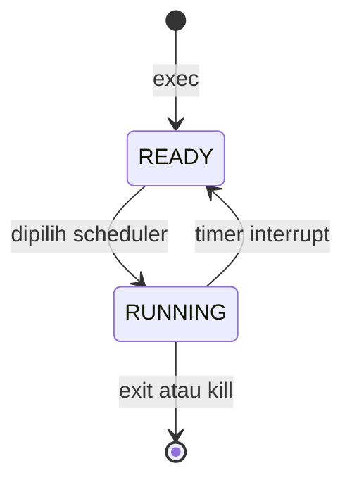

| Bagian buku | Status |
| :--- | :---: |
| 4.1 Process | ✅ |
| 4.2 Scheduler | ✅ |
| 4.3.1 Process Entrypoint & Exit | ✅ |
| 4.3.2 Process Management & Command | ✅ |
| 4.3.3 Clock | ✅ |
| 4.3.4 External Application | ✅ |
| 4.3.5 Bonus: Environment Variables (PATH) | ✅ ✦ |
| 4.3.6 Bonus: Separate Shell Commands | ✅ ✦ |
| 4.3.7 Grand Finale (README ini) | ✅ |


**Kenapa ada Topaz di sini?** Perintah terpisah (4.3.6) bertukar data dengan shell lewat *shared memory*, salah satu bentuk **IPC** (*Inter-Process Communication*). Topaz juga orang IPC, walau IPC versi dia mengurus utang, bukan buffer.

<br clear="left"/>

</details>

<details>
<summary><b>✦ Warp 1× : klik untuk menarik fitur bintang 5</b></summary>

<p align="center">
  
</p>

<p align="center">
  <b>Selamat!</b> Kamu mendapatkan <b>priasolOS ★★★★★</b><br>
  <sub>Termasuk: 1 kernel 32-bit, 16 slot proses, 1024 slot swap, dan tak terhitung triple fault yang sudah dikalahkan.</sub>
</p>

</details>

<p align="center"></p>

## Main Menu

Setelah boot, shell menampilkan animasi loading lalu **Main Menu** (tekan tombol apa saja untuk melewati animasi). Navigasi dengan Panah Atas/Bawah + Enter, atau langsung tekan angka `1` sampai `4`.

| Pilihan | Isi |
| :---: | :--- |
| `1` | Masuk ke terminal (priasol-sh) |
| `2` | Main ZZZ Rhythm Game (Robin Edition) |
| `3` | Info sistem (`neofetch`) |
| `4` | Panduan & Shortcut: isi yang sama dengan perintah `help`, ditampilkan per halaman (Panah Atas/Bawah untuk ganti halaman) |

Dari terminal, ketik `menu` untuk kembali ke Main Menu.

<p align="center"></p>

## Perintah Shell


Prompt shell: `priasolOS@<cwd> $`. Perintah *built-in* dijalankan langsung oleh shell, sedangkan program di `/bin` dijalankan sebagai proses terpisah lewat PATH.

| Perintah | Jenis | Fungsi |
| :--- | :---: | :--- |
| `cd <folder>` | built-in | Pindah direktori (`..` untuk naik) |
| `exec <program>` | built-in | Jalankan program dari folder sekarang atau root (`exec ./hello` juga bisa) |
| `ps` | built-in | Tampilkan PID, state, dan nama proses |
| `kill <pid>` | built-in | Hentikan proses |
| `export` | built-in | Tampilkan PATH, atau ubah dengan `export PATH=$PATH:/apps` |
| `menu` | built-in | Kembali ke Main Menu |
| `neofetch` | built-in | Info sistem dan maskot Robin |
| `touch <file>` | built-in | Buat file kosong baru |
| `help` | `/bin` | Daftar semua perintah, operator, dan shortcut |
| `ls [dir]` | `/bin` | Tampilkan isi direktori |
| `mkdir <nama>` | `/bin` | Buat folder baru |
| `cat <file>` | `/bin` | Tampilkan isi file teks |
| `cp [-r] <src> <dst>` | `/bin` | Salin file (`-r` untuk folder) |
| `rm [-r] <nama>` | `/bin` | Hapus file (`-r` untuk folder) |
| `mv <src> <dst>` | `/bin` | Pindah atau ganti nama file/folder |
| `find <nama>` | `/bin` | Cari file atau folder di seluruh file system |
| `grep <pola> [file]` | `/bin` | Cari pola (regex) dari file atau output pipeline |
| `echo <teks>` | `/bin` | Cetak teks |
| `clear` | `/bin` | Bersihkan layar terminal |
| `clock` | `/bin` | Jam di pojok kanan bawah. Pakai `clock &` agar berjalan di background |
| `hello` | `/bin` | Aplikasi Hello World |
| `rhythm` | `/bin` | ZZZ Rhythm Game + Robin Endless |
| `badapple` | `/bin` | Animasi Bad Apple!! (`q` / Esc untuk keluar) |

**Operator shell**

| Operator | Fungsi |
| :--- | :--- |
| `cmd1 \| cmd2` | Pipeline: output `cmd1` menjadi input `cmd2` (misalnya `ls \| grep sh`) |
| `cmd > file` | Tulis output ke file |
| `cmd >> file` | Tambahkan output ke akhir file |
| `prog &` | Jalankan program di background |

**Shortcut keyboard**

| Tombol | Fungsi |
| :--- | :--- |
| Tab | Autocomplete perintah dan nama file (saran tampil samar saat mengetik) |
| Panah Atas / Bawah | Riwayat perintah |
| PageUp / PageDown (atau Shift + Panah) | Scroll layar |
| Ctrl+C / Ctrl+U | Batalkan / hapus baris ketikan |
| Ctrl+L | Bersihkan layar tanpa menghapus ketikan |
| Esc | Hentikan program yang sedang berjalan di foreground |

<br clear="right"/>

<details open>
<summary><b>✦ Coba sendiri</b></summary>

```text
priasolOS@/ $ hello
Hello World!
priasolOS@/ $ clock &
Berjalan di background
priasolOS@/ $ ps
PID   STATE    NAME
1     RUNNING  shell
3     READY    clock
priasolOS@/ $ kill 3
priasolOS@/ $ ls | grep shell
shell
priasolOS@/ $ echo halo dari /bin
halo dari /bin
priasolOS@/ $ export
PATH=/bin
priasolOS@/ $ mkdir a
priasolOS@/ $ cd a
priasolOS@/a $ hello
Hello World!
```

Program yang dijalankan tanpa `&` ditunggu shell sampai selesai. Tekan **Esc** untuk menghentikan program yang tidak pernah selesai sendiri, misalnya `clock`.

</details>

<p align="center"></p>

## System Call


Dipanggil dengan `int 0x30`. Nomor layanan di `eax`, parameter di `ebx`, `ecx`, `edx`.

<br clear="right"/>

| `eax` | Layanan | `ebx` | `ecx` | `edx` |
| :---: | :--- | :--- | :--- | :--- |
| 0 | `read` | pointer request | pointer return code | – |
| 1 | `read_directory` | pointer request | pointer return code | – |
| 2 | `write` | pointer request | pointer return code | – |
| 3 | `delete` | pointer request | pointer return code | – |
| 4 | getchar | pointer char | – | – |
| 5 | putchar | karakter | warna | – |
| 6 | puts | pointer string | panjang | warna |
| 7 | aktifkan keyboard | – | – | – |
| 8 | bersihkan layar | – | – | – |
| 10 | exit | exit code | – | – |
| 11 | exec (buat proses baru) | pointer request | pointer return code | – |
| 12 | kill | PID | pointer return code | – |
| 13 | ps | pointer array `ProcessInfo` | jumlah maksimum | pointer jumlah hasil |
| 14 | baca jumlah tick timer | pointer `uint32_t` | – | – |
| 15 | ambil / lepas fokus keyboard | 1 ambil, 0 lepas | – | – |
| 16 | baca status tombol (key matrix) | pointer array tombol ditekan | pointer array tombol baru ditekan | – |
| 17 | PC Speaker | frekuensi (0 = diam) | – | – |
| 20 | baca waktu CMOS | pointer `struct CMOSTime` | – | – |
| 21 | tulis teks di posisi tetap | pointer string | panjang | `(row << 16) \| (col << 8) \| warna` |
| 22 | exec dengan argumen | pointer `ExecArgsRequest` | pointer PID hasil | – |
| 23 | cek proses masih hidup | PID | pointer `bool` | – |
| 24 | tulis shared memory | channel (0 input, 1 output) | pointer data | panjang |
| 25 | baca shared memory | channel | pointer buffer | pointer panjang |

<p align="center"></p>

## Galeri Kru

<p align="center"></p>

<p align="center"><i>Setiap kru adalah sebuah proses. Klik kartunya untuk melihat gambar penuh.</i></p>

<table align="center">
<tr>
<td align="center"><a href="assets/hsr/kafka.jpg"></a><br><sub><b>PID 1 · Kafka</b><br>RUNNING · ★★★★★</sub></td>
<td align="center"><a href="assets/hsr/black-swan.jpg"></a><br><sub><b>PID 2 · Black Swan</b><br>READY · Memokeeper</sub></td>
<td align="center"><a href="assets/hsr/topaz.webp"></a><br><sub><b>PID 3 · Topaz</b><br>READY · IPC</sub></td>
<td align="center"><a href="assets/hsr/kru-19.jpg"></a><br><sub><b>PID 4</b><!-- tambahkan nama --><br>READY</sub></td>
</tr>
<tr>
<td align="center"><a href="assets/hsr/kru-06.jpg"></a><br><sub><b>PID 5</b><!-- tambahkan nama --><br>READY</sub></td>
<td align="center"><a href="assets/hsr/kru-08.jpg">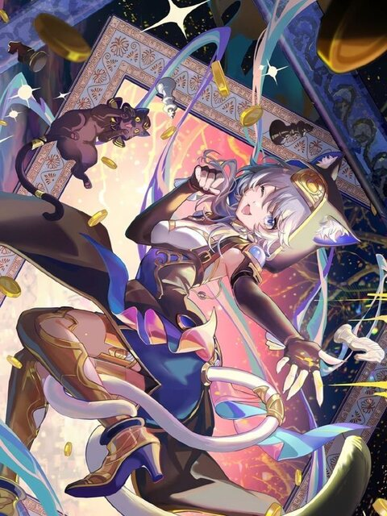</a><br><sub><b>PID 6</b><!-- tambahkan nama --><br>READY</sub></td>
<td align="center"><a href="assets/hsr/kru-09.jpg"></a><br><sub><b>PID 7</b><!-- tambahkan nama --><br>READY</sub></td>
<td align="center"><a href="assets/hsr/kru-10.jpg"></a><br><sub><b>PID 8</b><!-- tambahkan nama --><br>READY</sub></td>
</tr>
<tr>
<td align="center"><a href="assets/hsr/kru-11.jpg"></a><br><sub><b>PID 9</b><!-- tambahkan nama --><br>READY</sub></td>
<td align="center"><a href="assets/hsr/kru-14.jpg">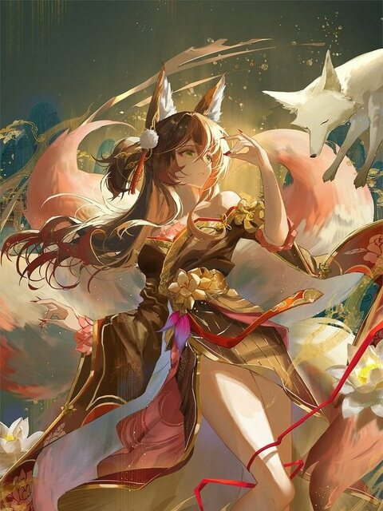</a><br><sub><b>PID 10</b><!-- tambahkan nama --><br>READY</sub></td>
<td align="center"><a href="assets/hsr/kru-15.jpg"></a><br><sub><b>PID 11</b><!-- tambahkan nama --><br>READY</sub></td>
<td align="center"><a href="assets/hsr/kru-16.jpg">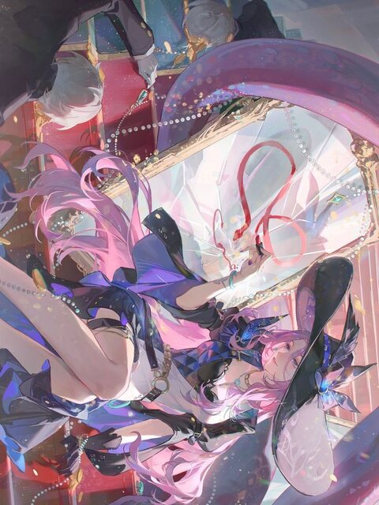</a><br><sub><b>PID 12</b><!-- tambahkan nama --><br>READY · art by @vvsimyeol</sub></td>
</tr>
<tr>
<td align="center"><a href="assets/hsr/kru-17.jpg">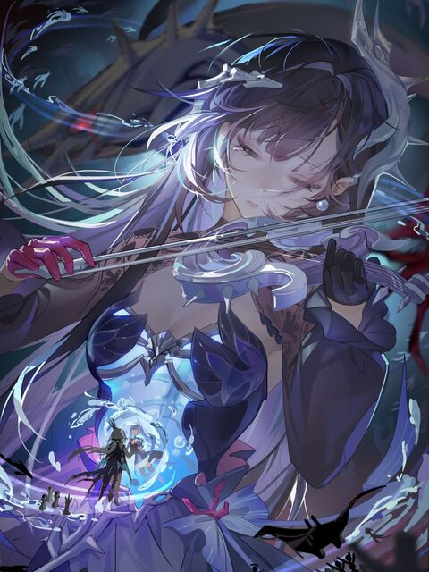</a><br><sub><b>PID 13</b><!-- tambahkan nama --><br>READY</sub></td>
<td align="center"><a href="assets/hsr/kru-18.jpg">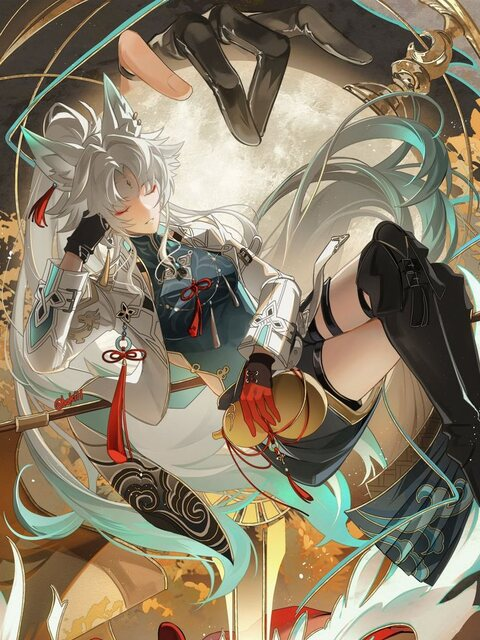</a><br><sub><b>PID 14</b><!-- tambahkan nama --><br>READY</sub></td>
<td align="center">✦<br><br><b>PID 15</b><br><sub>slot kosong<br></sub><br><br>✦</td>
<td align="center">✦<br><br><b>PID 16</b><br><sub>slot kosong<br><code></code></sub><br><br>✦</td>
</tr>
</table>

<p align="center"><sub>16 slot, persis batas <code>PROCESS_COUNT_MAX</code>.</sub></p>

<p align="center"></p>

## Prasyarat

Linux atau WSL (Ubuntu) dengan:
- `gcc` (dengan dukungan `-m32`), `nasm`, `ld` dan `size` (binutils)
- `genisoimage`
- `qemu-system-i386` dan `qemu-img`
- `make`

```bash
sudo apt update
sudo apt install build-essential gcc-multilib nasm genisoimage qemu-system-x86 qemu-utils
```

<p align="center"></p>

## Cara Build dan Run

1. **Build lalu jalankan di QEMU:**
   ```bash
   make run
   ```
   Perintah ini memasukkan `shell`, `clock`, `hello`, dan `rhythm` ke root, membuat folder `/bin` berisi aplikasi dan semua perintah terpisah (`ls`, `cat`, `grep`, `help`, dan lainnya), serta folder `/badapple` berisi data video. Disk `storage.bin` berukuran 8 MiB: 4 MiB pertama EXT2, 4 MiB terakhir swap space. Disk lama berukuran 4 MiB otomatis diperbesar tanpa menghapus isinya.

2. **Mulai dari disk kosong** (misalnya setelah mengubah isi file system):
   ```bash
   rm -f bin/storage.bin
   make run
   ```

3. **Uji swap dengan RAM kecil** (tanpa mengubah kode):
   ```bash
   make run SYSTEM_MEMORY_MB=5
   ```
   Kernel dan QEMU sama-sama memakai RAM 5 MiB. Shell (272 page) sudah lebih besar dari RAM yang tersisa, jadi sejak boot kernel harus memindahkan page ke swap. Jalankan beberapa program (`clock &`, `hello`, `rhythm`, `ls | grep sh`) untuk memaksa swap in/out antar proses.

4. **Hapus hasil build (termasuk `storage.bin`):**
   ```bash
   make clean
   ```

5. **Debug dengan VS Code:** jalankan konfigurasi debug di `.vscode` (QEMU dijalankan dengan `-s -S`, GDB tersambung ke port 1234).

<p align="center">
  
  <br>
  <sub>Ilustrasi urutan inisialisasi di <code>kernel_setup()</code>, bukan rekaman layar.</sub>
</p>

<!-- Tambahkan screenshot QEMU asli di sini, misalnya:
<p align="center"></p>
-->

<details>
<summary><b>✦ Troubleshooting</b> (klik)</summary>


- **Jendela QEMU tidak muncul di WSL:** gunakan WSLg (Windows 11 atau Windows 10 terbaru) atau jalankan X server.
- **Jam tidak sesuai zona waktu:** QEMU dijalankan dengan `-rtc base=localtime`. Jika masih UTC, ubah `CLOCK_UTC_OFFSET_HOURS` di `src/user/apps/clock.c` menjadi `7` untuk WIB.
- **Shell seperti diam setelah menjalankan `clock`:** shell sedang menunggu `clock` selesai. Tekan **Esc**, lalu jalankan `clock &`.
- **QEMU restart terus-menerus:** biasanya *triple fault*. Jalankan lewat debugger dan cek GDT, IDT, atau page table terakhir yang diubah.

<sub><i>Ekspresi resmi kelompok saat menghadapi triple fault →</i></sub>

<br clear="right"/>

</details>

<p align="center"></p>

## Struktur Direktori

```text
.
├── .docs/                      # jurnal pengerjaan per milestone
├── .kit/                       # kit bawaan spesifikasi (ch1–ch4)
├── .vscode/                    # konfigurasi build & debug
├── assets/                     # aset README: SVG animasi, GIF, galeri
├── bin/                        # hasil build (tidak di-commit): kernel, OS2025.iso, storage.bin, program user
├── other/
│   ├── grub1                   # bootloader GRUB Legacy
│   └── menu.lst                # konfigurasi menu GRUB
├── src/
│   ├── header/                 # semua header (.h), dikelompokkan: cpu, driver, filesystem, memory,
│   │                           #   process, scheduler, stdlib, text
│   ├── kernel/                 # semua kode ring 0 (diambil otomatis oleh Makefile)
│   │   ├── kernel.c            # kernel_setup()
│   │   ├── kernel-entrypoint.s # entry Multiboot + higher half
│   │   ├── linker.ld           # linker script kernel
│   │   ├── cpu/                # gdt, idt, interrupt + syscall dispatcher, intsetup.s, portio
│   │   ├── driver/             # framebuffer, keyboard, disk (ATA PIO), cmos
│   │   ├── filesystem/         # ext2.c (juga dipakai inserter di host)
│   │   ├── memory/             # paging.c, swap.c
│   │   └── process/            # process.c, scheduler.c, context-switch.s, exec_args.c
│   ├── user/                   # semua program ring 3
│   │   ├── lib/                # crt0.s, crt0-cmd.s, user-linker.ld, cmd-linker.ld, cmd_runtime.c
│   │   ├── shell/              # shell.c, shell_cmd.c (implementasi perintah), shell_path.c (PATH)
│   │   ├── cmd/                # perintah terpisah: ls, mkdir, cat, grep, find, cp, rm, mv, echo, clear, help
│   │   └── apps/               # clock, hello, rhythm (+ robin_chart.h), badapple (+ badapple.dat)
│   ├── stdlib/                 # string.c (memcpy, strlen, ...), dipakai kernel, user, dan host
│   └── external/               # inserter (berjalan di host)
├── Makefile
├── README.md
└── mascot.jpg
```

<p align="center"></p>

## Batasan yang Diketahui


- File system EXT2 berukuran 4 MiB, dan satu file maksimal 71.680 byte (12 blok langsung + 1 *single indirect*).
- Menulis file dengan ukuran 0 byte menghasilkan direktori, bukan file kosong (karena itu `touch` membuat file 1 byte).
- `cp` dan `mv` tidak tahu ukuran asli file, sehingga byte bernilai 0 di **akhir** file ikut terpotong saat disalin.
- Swap space maksimal 1024 page (4 MiB). Jika RAM dan swap sama-sama penuh, program baru ditolak (`exec: Memori tidak cukup`).
- Maksimal 16 proses berjalan bersamaan.
- `export` hanya mendukung variabel `PATH`, dengan panjang maksimal 256 karakter.

<br clear="right"/>

<p align="center"></p>

## Referensi

- IF2130 – Book I: Protected Mode x86, Edisi 4
- [OSDev Wiki](https://wiki.osdev.org) – GDT, IDT, PIC, CMOS, Paging
- Intel® 64 and IA-32 Architectures Software Developer's Manual, Volume 3A

## Kredit Gambar

- Karakter Honkai: Star Rail © HoYoverse. Fan art di README ini milik para artisnya masing-masing dan dipakai untuk keperluan pribadi, non-komersial.
- Ilustrasi PID 12 oleh [@vvsimyeol](https://x.com/vvsimyeol).
- Animasi SVG (header, divider, footer, langit berbintang, rasi bintang, peta perjalanan, warp, scheduler, boot) dibuat khusus untuk priasolOS.

<p align="center"></p>

<div align="center">
  
  <br>
  <sub>Dibuat dengan banyak triple fault oleh kelompok priasolOS.</sub>
  <br>
  <sub><em>It's the fruit of our hard work after all.</em></sub>
</div>
